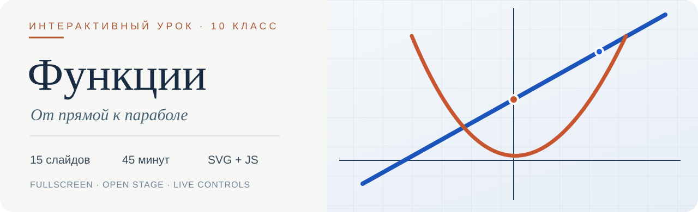
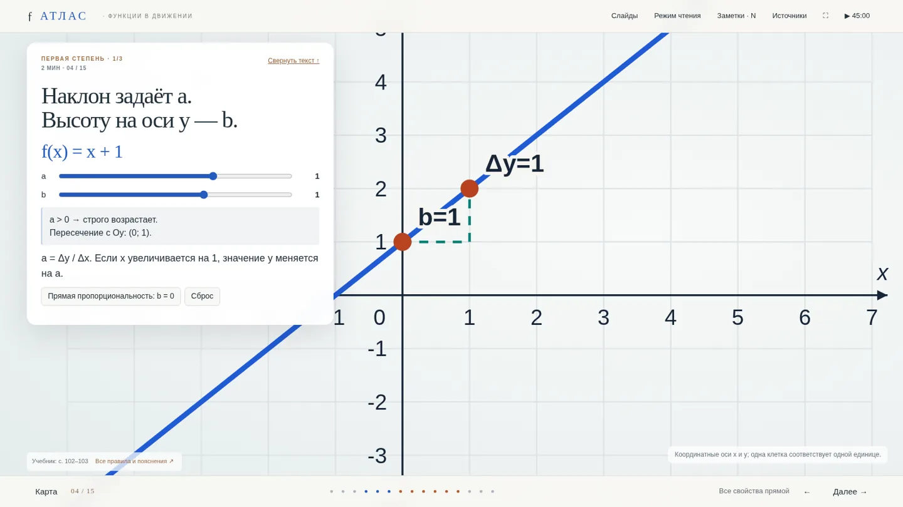

<p align="center">
  
</p>

<p align="center">
  <a href="https://xondell.github.io/interactive-functions/"></a>
  
  
  
</p>

<p align="center">
  <b>Математика, с которой можно взаимодействовать.</b><br />
  Графики на весь экран, текст — в плавающей панели слева, параметры меняются в реальном времени.
</p>

<p align="center"><strong><a href="https://xondell.github.io/interactive-functions/">Запустить презентацию →</a></strong> · <a href="#-навигация">Управление</a> · <a href="#-структура-урока">План урока</a> · <a href="#-разработка">Исходники</a></p>

---

### Предпросмотр

[](https://xondell.github.io/interactive-functions/)

> **Без рамок и карточек вокруг графика.** Диаграмма живёт в единой полноэкранной сцене. Панель слева можно свернуть, чтобы оставить на экране только интерактивную математику.

### ✦ Что внутри

| Возможность | Описание |
| :--- | :--- |
| **Интерактивные графики** | Линейная, квадратичная и другие функции; динамическое изменение коэффициентов |
| **Открытая сцена** | SVG-графики на весь экран, без искусственной рамки вокруг изображения |
| **Плавающая панель** | Теория, формулы и элементы управления слева; панель можно скрыть |
| **Практика** | Вопросы, ответы, мгновенная обратная связь |
| **Режимы просмотра** | Показ слайдов, последовательное чтение, полноэкранный режим |
| **Инструменты преподавателя** | Таймер на 45 минут, заметки выступающего, меню глав |
| **Работает без сервера** | Вся презентация находится в `index.html`; нет CDN, сборщиков и внешних зависимостей |

### ⌨ Навигация

| Действие | Управление |
| :--- | :--- |
| Следующий / предыдущий слайд | `→` / `←`, `Page Down` / `Page Up` |
| Первый / последний слайд | `Home` / `End` |
| Полный экран | `F` или кнопка `⛶` |
| Свернуть / показать текст | `T` или кнопка в верхней части панели |
| Заметки для выступающего | `N` |
| Меню глав | Кнопка **Слайды** |
| Режим чтения | Кнопка **Режим чтения** |
| Таймер урока | Нажмите на таймер для запуска или паузы |

> Заметки показываются в текущем окне, а не в отдельном приватном окне преподавателя.

### ◈ Структура урока

| Блок | Слайды | Минуты |
| :--- | :---: | ---: |
| Обзор, понятие функции и её свойства | 01–03 | 7 |
| Функция первой степени | 04–06 | 8 |
| Функция второй степени | 07–12 | 17 |
| Другие семейства функций | 13 | 3 |
| Итоговая практика | 14–15 | 10 |
| **Итого** | **15** | **45** |

### ⌁ Запуск локально

Просто скачайте репозиторий и откройте `index.html` в современном браузере. Интернет и установка зависимостей **не нужны**.

```bash
git clone https://github.com/xondell/interactive-functions.git
cd interactive-functions
python3 -m http.server 8000   # необязательно: запуск локального сервера
```

Затем откройте `http://localhost:8000`. Можно обойтись без сервера и открыть `index.html` двойным кликом.

### ◉ Разработка

```text
.
├── index.html                 # автономная презентация; главная страница GitHub Pages
├── assets/
│   ├── cover.svg              # обложка README
│   └── preview.webp           # реальный скриншот презентации
├── source/
│   ├── build.py               # генерация HTML-презентации
│   ├── app.js                 # интерактивность, графики, навигация
│   ├── book.js                # дополнительная теория
│   ├── slides.json            # сценарий 15 слайдов
│   ├── dist/style.css         # оформление
│   └── tests/check.cjs        # программные проверки
├── COVERAGE.md                # связь материалов с учебником
├── QA.md                      # объём проведённых проверок
└── SPEAKER_NOTES.md           # заметки преподавателя
```

Чтобы пересобрать презентацию после редактирования исходников:

```bash
cd source
python3 build.py
node tests/check.cjs
```

`build.py` создаёт `source/dist/index.html`. Для обновления сайта замените этим файлом корневой `index.html`, затем сделайте коммит и `git push`. GitHub Pages автоматически опубликует изменения из ветки `main`.

### Источники и достоверность

Материалы подготовлены по учебнику **И. Акири, П. Ефрос, В. Гарит, Н. Продан, «Математика. 10 класс», Prut Internaţional, 2025**. Соответствие страниц и тем — в [COVERAGE.md](COVERAGE.md). Формулы и интерактивная логика проверялись программно; детали — в [QA.md](QA.md).

**Права:** репозиторий публичен для просмотра, но отдельная лицензия на копирование и перераспространение не предоставлена.

---

<p align="center"><sub>Сделано для понимания математики через взаимодействие, а не через статичные картинки.</sub></p>
