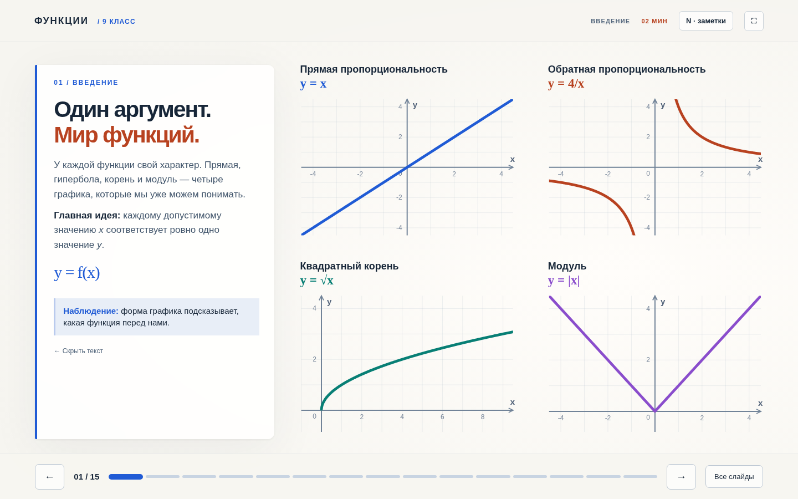
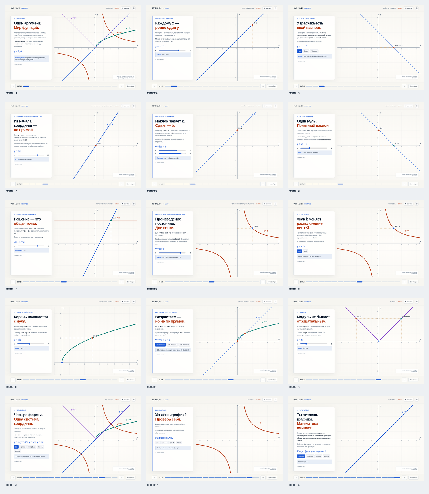

<div align="center">

# Функции — интерактивная презентация

### Математика · 9 класс · 15 слайдов · 45 минут

[](https://xondell.github.io/interactive-functions/)


[**▶ Запустить презентацию**](https://xondell.github.io/interactive-functions/) · [**Скриншоты всех слайдов**](#-галерея-слайдов) · [**Запуск локально**](#-запуск-локально)

</div>



## Что внутри

Это интерактивный урок по функциям для учеников **9 класса**. Материал о квадратичной функции и параболе исключён: вместо него — только графики, с которыми класс уже знаком.

- **Прямая и обратная пропорциональность**, **линейная функция**, **квадратный корень** и **модуль**.
- Настоящие интерактивные SVG-графики: изменение коэффициентов и перемещение точек.
- Графики занимают сцену; текст и управление расположены в панели слева, которую можно свернуть.
- На первом слайде четыре семейства показаны **на отдельных координатных осях** — без пересечений друг с другом.
- Встроенные заметки преподавателя, мини-викторина и полноэкранный показ.

## План урока

| Слайды | Тема | Время |
|:--:|:--|--:|
| 01–03 | Знакомство с функцией, область определения, нули, свойства | 7 мин |
| 04–07 | Прямая пропорциональность, линейная функция, чтение графиков и пересечения | 12 мин |
| 08–09 | Обратная пропорциональность и гипербола | 7 мин |
| 10–11 | Квадратный корень и сравнение графиков | 6 мин |
| 12–13 | Модуль и сравнение семейств функций | 6 мин |
| 14–15 | Проверка знаний и итоги | 7 мин |
| | **Всего** | **45 мин** |

## Управление

| Действие | Клавиши или кнопка |
|:--|:--|
| Следующий / предыдущий слайд | `→` / `←` |
| Показать заметки выступающего | `N` |
| Скрыть / показать панель | `T` |
| Полноэкранный режим | `F` |
| Выбрать слайд | «Все слайды» |
| Изменить график | Ползунки и кнопки на слайдах |

## 🖼 Галерея слайдов



<details>
<summary>Открыть отдельные скриншоты</summary>

| | | |
|:--:|:--:|:--:|
| [01](screenshots/01.png) | [02](screenshots/02.png) | [03](screenshots/03.png) |
| [04](screenshots/04.png) | [05](screenshots/05.png) | [06](screenshots/06.png) |
| [07](screenshots/07.png) | [08](screenshots/08.png) | [09](screenshots/09.png) |
| [10](screenshots/10.png) | [11](screenshots/11.png) | [12](screenshots/12.png) |
| [13](screenshots/13.png) | [14](screenshots/14.png) | [15](screenshots/15.png) |

</details>

## Запуск локально

Скачайте репозиторий и откройте `index.html` в браузере:

```bash
git clone https://github.com/xondell/interactive-functions.git
cd interactive-functions
python3 -m http.server 8000
```

Открыть: **http://localhost:8000**. Сервер необязателен: `index.html` также запускается непосредственно с диска. Сборка, npm, API-ключи и интернет для самой презентации не нужны.

## Структура опубликованной версии

```text
index.html                    # Стартовая страница GitHub Pages
app.js                        # 15 слайдов, графики, заметки, навигация
styles.css                    # Сцена и интерфейс
presentation-standalone.html  # Автономная версия в одном файле
overview.png                  # Обзор слайдов
screenshots/                  # Скриншоты 01.png—15.png
.nojekyll                     # Публикация статических файлов без Jekyll
```

**Публикация:** GitHub Pages, ветка `main`, папка `/` (корень репозитория). После нового `git push` в `main` сайт обновляется автоматически.

> **Примечание о прежней версии:** если в репозитории есть старая папка `source/` или документы для 10 класса, они сохранены как исторические материалы. Опубликованная версия для 9 класса загружается из **корневых** `index.html`, `app.js` и `styles.css`; старый генератор запускать не нужно.

---

<div align="center">

**[Перейти к интерактивной презентации →](https://xondell.github.io/interactive-functions/)**

</div>
